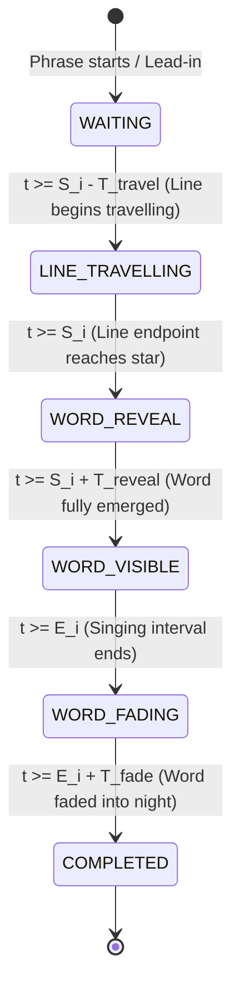

# TASK A.2 — Needle Windows: Minimal Constellation Lyrics Animation & Motion Refinement

**Project:** `needle-windows`  
**Milestone:** Minimal Constellation Lyrics Animation & Motion Refinement  
**Version:** 0.1.0  
**Platform:** Windows 11 x64  
**Framework:** Tauri 2 + React 19 + TypeScript + Rust + Tailwind CSS  

---

## 1. Executive Summary

TASK A.2 refines the **Stars** animation style in Needle Windows into a minimal, elegant, connected constellation experience.

The previous falling-star trajectory model has been completely replaced. The new engine operates as an orderly celestial journey:
1. **Clean Cinematic Background**: Powered by the existing **Ambient Motion** background in the Expressive preset. All floating dust, particles, and random debris are strictly suppressed (`particleIntensity: 0.0`).
2. **Deterministic Star Points**: Small, crisp points of light with delicate halos. Positions are calculated deterministically from phrase structure and stay 100% stationary throughout each phrase (no downward falling, no per-frame jitter).
3. **Sequential Travelling Connection Lines**: A thin straight luminous line travels from the previous star point towards the next star with a clearly visible moving tip dot and smooth easing (`easeInOutQuad`).
4. **Line-Triggered Word Reveal**: A lyric word is strictly invisible until the moving line reaches its star. Upon arrival ($t \ge S_i$), the word emerges smoothly from the star point.
5. **In-Place Star Fade**: Once sung, the word gently fades out in place like a distant star receding into the night sky, preserving constellation line continuity for subsequent words.

---

## 2. Exact Constellation Animation Behaviour & State Machine

Each word in a lyric phrase progresses through a deterministic 6-phase state machine:

$$\text{WAITING} \longrightarrow \text{LINE\_TRAVELLING} \longrightarrow \text{WORD\_REVEAL} \longrightarrow \text{WORD\_VISIBLE} \longrightarrow \text{WORD\_FADING} \longrightarrow \text{COMPLETED}$$



### Phase Details:

| Phase | Timing Window | Visual Representation | Word Opacity | Star Node & Line State |
|---|---|---|---|---|
| **Phase 1: WAITING** | $t < S_i - T_{\text{travel}}$ | Dormant star point at $(x_i, y_i)$ | $\alpha = 0$ (Strictly invisible) | Star node $\alpha = 0.35$; no incoming line drawn yet |
| **Phase 2: LINE_TRAVELLING** | $S_i - T_{\text{travel}} \le t < S_i$ | Straight line travelling from $(x_{i-1}, y_{i-1})$ to $(x_i, y_i)$ | $\alpha = 0$ (Strictly invisible) | Line drawn with moving luminous tip dot; star halo anticipates arrival |
| **Phase 3: WORD_REVEAL** | $S_i \le t < S_i + T_{\text{reveal}}$ | Line has arrived; word emerges smoothly from star | $\alpha = \text{easeOutCubic}(p)$ ($0 \to 1$) | Star point reaches peak radiance; halo expands |
| **Phase 4: WORD_VISIBLE** | $S_i + T_{\text{reveal}} \le t < E_i$ | Word fully displayed above star | $\alpha = 1.0$, scale = $1.0$ | Active star halo; subtle audio-reactive pulse on beat hits |
| **Phase 5: WORD_FADING** | $E_i \le t < E_i + T_{\text{fade}}$ | Word gently fades out in place | $\alpha = 1.0 - \text{easeOutCubic}(p)$ | Position strictly static at $(x_i, y_i - \text{offsetY})$ (no falling!); star settles |
| **Phase 6: COMPLETED** | $t \ge E_i + T_{\text{fade}}$ | Word disappears | $\alpha = 0$ | Star point and line remain as faint constellation outline ($\alpha \approx 0.30$) |

---

## 3. Mathematical & Geometric Formulation

### 3.1 Stable Constellation Layout
For a phrase of $N$ words, each word $i \in [0, N-1]$ receives a stable coordinate $(x_i, y_i)$:
- **Horizontal Lane Span:**
  $$X_i = X_{\min} + \left(\frac{i}{N - 1}\right) \cdot (X_{\max} - X_{\min}) + \Delta X_i$$
  where $X_{\min} = \text{clamp}(0.16 \cdot W, 120, 260)$, $X_{\max} = W - X_{\min}$, and $\Delta X_i$ is a deterministic FNV-1a hash offset.
- **Vertical Celestial Undulation:**
  $$Y_i = \text{clamp}\left(0.50 \cdot H + \sin\left(\frac{i}{N-1} \cdot 1.6\pi + \text{seed}\right) \cdot 0.12H + \cos\left(\frac{i}{N-1} \cdot 2.8\pi\right) \cdot 0.04H + \Delta Y_i, \; 0.26H, \; 0.74H\right)$$
- **Origin Anchor $P_{-1}$:**
  For the first word ($i=0$), an entry anchor $P_{-1}$ is extrapolated backwards from $(x_0, y_0)$ to provide a natural starting point for the initial connection line.

### 3.2 Travelling Line Interpolation
During `LINE_TRAVELLING`:
$$p_{\text{line}} = \text{easeInOutQuad}\left(\frac{t - (S_i - T_{\text{travel}})}{T_{\text{travel}}}\right)$$
$$\vec{P}_{\text{tip}}(t) = \vec{P}_{i-1} + (\vec{P}_i - \vec{P}_{i-1}) \cdot p_{\text{line}}$$
At $\vec{P}_{\text{tip}}$, an inner crisp white core ($r=2.5\text{px}$) and subtle outer luminous halo ($r=5.0\text{px}$) trace the path in real time.

---

## 4. Expressive Preset Configuration

The `expressive` preset configuration in `src/lyrics/animation/animationTypes.ts` has been updated to embody this minimal, cinematic constellation aesthetic:

```typescript
expressive: {
  preset: 'expressive',
  style: 'stars',
  background: 'ambient',   // Ambient Motion
  fontFamily: 'display',
  fontWeight: 'bold',
  letterSpacing: 0.5,
  lineSpacing: 1.6,
  speed: 1.0,
  intensity: 1.0,
  glowEnabled: true,
  glowIntensity: 0.8,      // Subtle starlight glow
  blurIntensity: 0.0,      // Sharp, crisp starlight
  particleIntensity: 0.0,  // Background particles strictly OFF
  reducedMotion: false,
  audioReactive: true,     // Subtle halo reactivity
}
```

In addition, `LyricsCanvasEngine` explicitly suppresses `ParticleRenderer` whenever `style === 'stars'`, ensuring that even custom user configurations never introduce cluttering particles into the Stars constellation.

---

## 5. Desktop Visual Verification

All visual evidence was captured live from the running Windows x64 production binary (`needle-windows.exe`):

### 5.1 Continuous Motion Demonstration (Animated GIF)
- **Continuous Constellation Journey:**  
  `task-a2-constellation-motion.gif` *(284 KB, 40 frames at 100ms intervals)*  
  Demonstrates consecutive words ("I've been tryin' to call", "I've been on my own for long enough"), showing:
  - Moving line tip travelling from star to star.
  - Word remaining invisible while line travels.
  - Word emerging only upon line arrival.
  - Word gently fading out in place while subsequent lines travel.
  - Zero downward falling movement.

### 5.2 Milestone States
1. **Line Travelling With Moving Tip:**  
   `task-a2-constellation-line-travel.png`  
   Thin straight line with moving tip dot travelling from "long" towards the dormant star for "enough"; "enough" is 100% invisible.
2. **Word Reveal On Arrival:**  
   `task-a2-constellation-word-reveal.png`  
   Moving tip arrives at destination star; "enough" emerges smoothly in place.
3. **Word Visible & Active Star Halo:**  
   `task-a2-constellation-word-visible.png`  
   "Maybe" fully visible above Star 0 with radiant halo; future stars waiting calmly along the constellation arc.
4. **Word Fading In Place:**  
   `task-a2-constellation-word-fading.png`  
   Line arrives at "can"; earlier words have gently faded into the night sky without downward drift.
5. **Expressive Ambient Motion Atmosphere:**  
   `task-a2-constellation-expressive-ambient.png`  
   Minimalist constellation floating on clean scarlet/crimson Ambient Motion background; zero particles or dust.
6. **Multilingual Unicode Verification:**  
   - `task-a2-constellation-telugu.png`: Telugu lyric `ఉండలేనే` (Undalene) from *Vellake* with warm gold constellation line.
   - `task-a2-constellation-hindi.png`: Hindi Devanagari `कैसे` (Kaise) from *Kesariya* with saffron/amber constellation line.

---

## 6. Automated Test Results

- **Unit Test Suites (`npm run test:unit`):** `65 passed, 0 failed` across 4 test suites.
  - `src/lyrics/animation/stars.test.ts`:
    * `stars: star positions are strictly deterministic and seed-repeatable` (PASS)
    * `stars: star points maintain horizontal sequential order and comfortable reading spacing` (PASS)
    * `stars: coordinates stay clamped within safe viewport margins` (PASS)
    * `stars: state machine sequence WAITING -> LINE_TRAVELLING -> WORD_REVEAL -> WORD_VISIBLE -> WORD_FADING -> COMPLETED` (PASS)
    * `stars: word fades away in place without downward falling drift` (PASS)
    * `stars: origin anchor provides seamless starting point for word 0` (PASS)
  - `src/lyrics/animation/engine.test.ts`: Deterministic star layout and non-overlapping lane verification (PASS).
- **Rust Backend Tests (`cargo test`):** `33 passed, 0 failed`.
- **TypeScript Typecheck (`npm run typecheck`):** `0 errors`.

---

## 7. Known Limitations & Edge Cases Handled

1. **Instrumental Breaks & Idle State:**  
   When no lyrics are active or during instrumental solos, Stars displays a calm 3-star resting constellation with a subtle `♪ · ♪` musical glyph.
2. **Line-Only & Low-Confidence Timing:**  
   When word-level timestamps are unavailable, the engine deterministically tokenizes line text via `tokenizeWordsUnicode` and distributes star points evenly across the conservative singing duration ($0.75 \times \text{lineInterval}$), ensuring consistent visual flow.
3. **Seeking & Pausing:**  
   Because all state transitions are pure mathematical functions of $t = \text{positionMs}$, pausing immediately freezes the travelling line and active word; seeking forward or backward immediately reconstructs the exact constellation state without replay delays or lingering past words.
