# TASK A.2 — Needle Windows: New Constellation Lyric Effect

**Project:** `needle-windows`  
**Milestone:** New Constellation Lyric Effect (Preserving Existing Stars)  
**Version:** 0.1.0  
**Platform:** Windows 11 x64  
**Framework:** Tauri 2 + React 19 + TypeScript + Rust + Tailwind CSS  

---

## 1. Executive Summary

TASK A.2 introduces a completely new animation style named **Constellation** inspired by the observable design language of Needle for Mac, while preserving the existing **Stars** animation completely untouched.

### Core Architecture:
1. **Preserved Existing Stars**: The existing Stars animation retains its continuous falling-star trajectory curves ($B(p) = (1-p)^2 P_0 + 2(1-p)p P_c + p^2 P_1$), luminous tapered trails, starlight embers, and orbital focal rings.
2. **New Independent Constellation Style**: A spatial 2D network across the entire screen composed of stationary star nodes and thin straight connecting lines.
3. **Word Anchoring**: Lyric words are statically anchored beside their assigned star points (above or below). **Words NEVER travel along connecting lines.**
4. **Visual Hierarchy**:
   - **Active word:** Prominent, large ($1.40\times$ scale), bold, pure crisp white with radiant album-tinted halo.
   - **Recently active words:** Smaller ($0.85\times$ scale), medium weight, gently fading out in place.
   - **Upcoming words:** Completely hidden ($\alpha = 0$) while their star points and connecting lines remain visible in the constellation network.
5. **Clean Cinematic Atmosphere**: Ambient Motion background in the `expressive` preset with background particles strictly suppressed (`particleIntensity: 0.0`).

---

## 2. Constellation Visual Composition & Geometry

### 2.1 Spatial 2D Layout (`ConstellationStyle.evaluateStarPosition`)
Unlike conventional lyrics or 1D horizontal rows, Constellation distributes star points across a 2D bounding area ($X \in [0.12W, 0.88W]$, $Y \in [0.22H, 0.78H]$) using deterministic astronomical templates (Ascending Arc, Zig-Zag 'W', S-Curve, Central Bow):

$$X_i = X_{\min} + \left(\frac{i}{N - 1}\right) \cdot (X_{\max} - X_{\min}) + \Delta X_i$$

$$Y_i = \text{clamp}(Y_{\text{template}}(i, N) + \Delta Y_i, \; 0.18H, \; 0.82H)$$

Deterministic FNV-1a hash algorithm (`hashToFloat`) guarantees 100% stable coordinates across all animation frames with zero random jitter.

### 2.2 Structural Network & Background Anchor Stars (`getConstellationNetwork`)
- **Primary Edges:** Thin straight lines (width $1.2\text{px}$, $\alpha \approx 0.24$) connecting adjacent lyric stars in sequence ($S_0 - S_1 - \dots - S_{N-1}$).
- **Active Edge Highlight:** When a word is active, the connecting line segment leading to it brightens ($\alpha \approx 0.55$, width $1.6\text{px}$).
- **Background Celestial Stars:** 4 to 6 subtle stationary anchor stars ($r = 1.8\text{px}$, $\alpha \approx 0.28$) positioned around the constellation perimeter and connected via thin branch lines to form a cohesive astronomical constellation network.

### 2.3 Strict Collision Avoidance
To prevent overlapping words and lines:
- If a star is in the lower half of the screen ($y_i > 0.48H$), its word is placed **above** ($y_i - \text{offsetY}$).
- If a star is in the upper half of the screen ($y_i \le 0.48H$), its word is placed **below** ($y_i + \text{offsetY}$).
- Words are never drawn on connecting lines or directly on star nodes.

---

## 3. Sequential Activation State Machine

```mermaid
stateDiagram-v2
    [*] --> WAITING: Phrase starts / Network formed
    WAITING --> STAR_ACTIVATING: t >= S_i - T_lead (Star illuminates smoothly)
    STAR_ACTIVATING --> WORD_REVEAL: t >= S_i (Word fades into view anchored to star)
    WORD_REVEAL --> WORD_EMPHASIS: t >= S_i + T_reveal (Active word reaches 1.4x scale)
    WORD_EMPHASIS --> WORD_FADING: t >= E_i (Singing ends; word fades in place)
    WORD_FADING --> COMPLETED: t >= E_i + T_fade (Word disappears)
    COMPLETED --> [*]
```

| Phase | Duration | Visual State | Word Opacity & Scale | Star Point Node |
|---|---|---|---|---|
| **WAITING** | $t < S_i - T_{\text{lead}}$ | Dormant star point in network | $\alpha = 0$ (Hidden) | Calm node ($r=2.8\text{px}, \alpha=0.45$) |
| **STAR_ACTIVATING** | $S_i - T_{\text{lead}} \le t < S_i$ | Star point gradually illuminates | $\alpha = 0$ (Hidden until star active) | Star illuminates smoothly ($\alpha \to 1.0$), halo expands |
| **WORD_REVEAL** | $S_i \le t < S_i + T_{\text{reveal}}$ | Word fades into view beside star | $\alpha: 0 \to 1.0$, scale: $1.10 \to 1.40$ | Radiant star node ($r=3.5\text{px}, \alpha=1.0$) |
| **WORD_EMPHASIS** | $S_i + T_{\text{reveal}} \le t < E_i$ | Active word: prominent visual hierarchy | $\alpha = 1.0$, scale = $1.40\times$ (Bold) | Peak radiance + subtle audio-reactive beat pulse |
| **WORD_FADING** | $E_i \le t < E_i + T_{\text{fade}}$ | Word gently fades away in place | $\alpha: 1.0 \to 0$, scale: $1.40 \to 0.85$ | Position strictly static (NO falling!); halo settles |
| **COMPLETED** | $t \ge E_i + T_{\text{fade}}$ | Word gone; star node remains in network | $\alpha = 0$ | Calm baseline node ($\alpha = 0.35$) |

---

## 4. Preservation of Existing Stars (Non-Regression)

The existing **Stars** animation style has been verified to remain 100% intact:
- Retains quadratic Bézier falling-star flight trajectories:
  $$B(p) = (1-p)^2 P_0 + 2(1-p)p P_c + p^2 P_1$$
- Retains 5-step luminous tapered falling star trails with starlight embers.
- Retains persistent constellation ribbons connecting flying words.
- Retains radiant 4-point telescopic diffraction spikes.
- Both styles (`stars` and `constellation`) exist side-by-side in `KineticStyleId`, `LyricsCanvasEngine`, `LyricsPlayerApp`, and `LyricsAnimationStudio`.

---

## 5. Desktop Visual Verification

### 5.1 New Constellation Style
- **Spatial Constellation Network**: `task-a2-constellation-network.png`  
  *Demonstrates full 2D spatial distribution across screen, active word "long" anchored above star, background stars and connecting lines forming an astronomical network.*
- **Visual Hierarchy & Word Sizing**: `task-a2-constellation-hierarchy.png`  
  *Demonstrates large prominent active word "Maybe" ($1.40\times$) vs upcoming dormant stars in the constellation network.*
- **Continuous Motion Demonstration (Animated GIF)**: `task-a2-constellation-motion.gif` *(354 KB, 40 frames at 100ms intervals)*  
  *Live recording demonstrating consecutive words in real-time motion: star activation, word reveal, active emphasis, in-place fade, and zero downward falling movement.*
- **Telugu (తెలుగు)**: `task-a2-constellation-telugu.png` (*Vellake: `ఉండలేనే`*)
- **Hindi (हिन्दी)**: `task-a2-constellation-hindi.png` (*Kesariya: `कैसे`*)

### 5.2 Existing Stars (Proof of Non-Regression)
- **Stars Unchanged**: `task-a2-stars-unchanged.png`  
  *Proves existing Stars retains its falling-star trajectories across deep space, diagonal star trails, starlight embers, and 4-point diffraction spikes.*

---

## 6. Automated Test Matrix

- **Unit Test Suite (`npm run test:unit`):** `68 passed, 0 failed` across 4 test suites.
  - `src/lyrics/animation/stars.test.ts`: 4 passed (falling-star trajectories, FNV-1a determinism, multi-word lane distribution, coordinate clamping).
  - `src/lyrics/animation/constellation.test.ts`: 5 passed (spatial distribution, network lines, visual hierarchy $1.4\times$ vs $0.85\times$, words anchored to stars and never on lines, in-place fade).
  - `src/lyrics/animation/engine.test.ts`: 4 passed (7-style registry, determinism, lane separation, reduced motion).
  - `src/lyrics/animation/fullscreen.test.ts`: 2 passed (responsive typography across 720p, 1080p, 1440p, 4K, 21:9 ultrawide).
- **Rust Backend Tests (`cargo test`):** `33 passed, 0 failed`.
- **TypeScript Typecheck (`npm run typecheck`):** `0 errors`.
