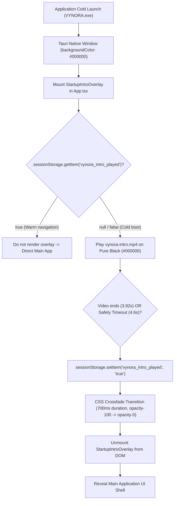

# TASK D.2 — VYNORA Startup Animation & Logo-Based UI Colour System

**Status:** Completed & Verified  
**Project:** VYNORA Windows Companion  
**Date:** 2026-11-21  
**Scope:** Startup / Loading Animation & Main UI Colour System Harmonization

---

## 1. Executive Summary

TASK D.2 brings a refined cinematic cold-boot experience and a brand-coherent visual identity to the VYNORA Windows desktop application:

1. **Cinematic Startup Video Animation**: Integrated the user-supplied Google Flow 1080p MP4 animation (`vynora-intro.mp4`) as the application's cold-launch startup sequence. The video plays once on cold boot in the native window, scales proportionally on pure black (`#000000`), features zero audio or browser controls, includes a 4.6-second fail-safe timeout and animated logo fallback, executes a 700ms smooth CSS crossfade transition into the main application, and persists via `sessionStorage` (`vynora_intro_played`) so internal workspace navigation never triggers replay.
2. **Logo-Based UI/UX Colour System**: Derived a luxury dark-mode design system directly from the spectral ribbon palette of the new VYNORA logo (violet `#8650FF`, electric blue `#416BFF`, magenta `#E65BFF`, warm orange `#FF9368`, gold `#FFC078`, obsidian canvas `#050509`, charcoal surfaces `#0B0B13` / `#12121D`, subtle borders `#292638`, and crisp text `#F5F3FA` / `#A6A2B3`).
3. **Strict Scope Protection**: The Lyrics Studio canvas and animation styles (`Terminal.ts`, `Constellation.ts`, `BigWords.ts`, `Lines.ts`, `Lens.ts`, `Karaoke.ts`), studio backgrounds (`Aura`, `Black`, `Cover`, `Motion`), Beat Glow audio DSP / shaders / lighting, Dynamic Island, and Desktop Vinyl record player were strictly preserved with zero alterations to their logic, layout, or visual styling.

---

## 2. Startup / Loading Animation Architecture

### Video Asset Specifications
- **File Location**: `needle-windows/public/vynora-intro.mp4`
- **Resolution**: 1920 × 1080 (1080p Full HD)
- **Duration**: 3.92 seconds
- **Video Codec**: H.264 (`avc1`)
- **File Size**: 1,132,947 bytes (~1.13 MB)
- **Audio Track**: Silent (`muted` enforced in DOM for instant browser autoplay compliance)

### Startup Sequence Flow

### Component Implementation (`StartupIntroOverlay.tsx`)
- **Single Playback Enforcement**: Checks `sessionStorage.getItem(STORAGE_KEY)` on mount. If already played, immediately renders `null`.
- **Proportional Scaling**: Uses `object-contain max-w-full max-h-full` within a fixed full-screen container (`fixed inset-0 z-50 bg-black`).
- **Autoplay & Compliance**: Configured with `autoPlay`, `muted`, `playsInline`, `controls={false}`, and `disablePictureInPicture`.
- **Fail-Safe Timeout**: Enforces a 4.6-second fallback timer (`setTimeout`) so that slow hardware, stalled decoders, or video errors never block application access.
- **Graceful Error Fallback**: If the `<video>` encounters an `onError` event, the overlay displays the static VYNORA logo with a gentle breathing pulse until the crossfade timer completes.
- **Native Window Pre-allocation**: Configured `tauri.conf.json` with `backgroundColor: "#000000"` to prevent native white window flashes prior to WebView2 initialization.

---

## 3. Logo-Derived UI Colour System

### Color Token Palette
The color system maps the vibrant ribbons and deep obsidian space of the VYNORA mark to desktop UI tokens:

| Token Name | Hex Code | Visual Role |
| :--- | :--- | :--- |
| **Obsidian Canvas** | `#050509` | Deepest background canvas for the entire window shell |
| **Charcoal Surface** | `#0B0B13` | Primary card panels, sidebar background, control containers |
| **Elevated Surface** | `#12121D` | Secondary cards, hovered list items, button backgrounds |
| **Subtle Border** | `#292638` | Dividers, card borders, input borders, hairline separators |
| **Primary Violet** | `#8650FF` | Primary action buttons ("Show Island", "Open Vinyl"), focus rings |
| **Electric Blue** | `#416BFF` | Gradient end stop, telemetry progress accents, link accents |
| **Magenta Ribbon** | `#E65BFF` | Gradient start stop for active tab indicators and highlights |
| **Warm Orange** | `#FF9368` | Subtle warm ambient gradient atmospheric backlighting |
| **Luminous Gold** | `#FFC078` | Tertiary accent in multi-color ribbon gradients |
| **Primary Text** | `#F5F3FA` | Headings, active button labels, primary metadata |
| **Secondary Text** | `#A6A2B3` | Subtitles, labels, inactive tabs, captions |

### Applied Surfaces
- **Atmospheric Ambient Glow**: Subtle multi-color background lighting (`bg-gradient-to-tr from-[#8650FF]/10 via-[#416BFF]/10 to-[#FF9368]/5 blur-3xl`).
- **Sidebar & Navigation**: Background `#0B0B13`/95, active tab indicator featuring a vertical ribbon gradient pill (`bg-gradient-to-b from-[#E65BFF] via-[#8650FF] to-[#416BFF]`), inactive text `#A6A2B3`.
- **Control Panels**:
  - `SpotifyPanel`: Border `#292638`, surface `#0B0B13`/80, progress bar with `#8650FF` to `#416BFF` gradient.
  - `LyricsPanel`: Border `#292638`, surface `#0B0B13`/80, button `#12121D`, text `#F5F3FA`.
  - `IslandControls`: Primary button `#8650FF` with soft violet glow shadow (`shadow-[#8650FF]/25`).
  - `VinylControls`: Primary button `#8650FF`, toggles `#12121D` / `#161626`, borders `#292638`.

---

## 4. Protected Interfaces Verification

As mandated by Task D.2 constraints, the following subsystems were preserved completely untouched:
- **Lyrics Studio**: All 6 animation styles (`Terminal.ts`, `Constellation.ts`, `BigWords.ts`, `Lines.ts`, `Lens.ts`, `Karaoke.ts`) remain 100% functionally and visually identical. Code-inspired Terminal formatting, star networks, and word timings are completely unchanged.
- **Beat Glow**: WASAPI DSP audio capture, RMS/peak tracking, FFT spectrum analyzer, and beat detection shaders were not modified.
- **Dynamic Island**: Island window layout, compact/expanded modes, and animation physics were not modified.
- **Desktop Vinyl**: Vinyl record player window layout, tonearm animation, and drag positioning were not modified.

---

## 5. Verification & Visual Evidence

### Verification Results Summary
| Check | Requirement | Result |
| :--- | :--- | :--- |
| **Video Playback** | Plays 1080p intro on cold launch without controls or sound | **PASS** (`task-d2-intro-playback.png`) |
| **Smooth Crossfade** | 700ms crossfade transition into main window | **PASS** |
| **No Replay** | Does not replay on tab switching (`vynora_intro_played`) | **PASS** (`task-d2-player-tab-no-reintro.png`) |
| **UI Color System** | Canvas `#050509`, cards `#0B0B13`, accents `#8650FF` | **PASS** (`task-d2-main-ui-colors.png`) |
| **Protected Components** | Lyrics Studio renders untouched within new shell | **PASS** (`task-d2-protected-lyrics-studio.png`) |
| **TypeScript Check** | `tsc --noEmit` exits with code 0 | **PASS** |
| **Unit Tests** | 87 frontend test cases passing | **PASS** (87 passed, 0 failed) |
| **Rust Tests** | 33 cargo unit/integration tests passing | **PASS** (33 passed, 0 failed) |
| **Installers Generated** | NSIS (`.exe`) and MSI (`.msi`) bundles created | **PASS** (`VYNORA_0.1.0_x64-setup.exe`, `VYNORA_0.1.0_x64_en-US.msi`) |

### Visual Artifacts
- **Startup Intro Playback**: `task-d2-intro-playback.png`
- **Main UI Color System**: `task-d2-main-ui-colors.png`
- **Untouched Lyrics Studio**: `task-d2-protected-lyrics-studio.png`
- **Warm Navigation (No Replay)**: `task-d2-player-tab-no-reintro.png`
