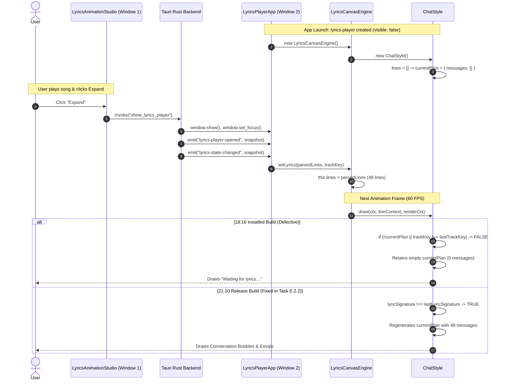

# TASK E.2.3 — VYNORA Chat-Only Fullscreen Lyrics Failure Investigation Report

**Project**: VYNORA (formerly Needle)  
**Task**: E.2.3 — Chat-Only Fullscreen Lyrics Failure (Root Cause Investigation)  
**Date**: November 21, 2026  
**Status**: INVESTIGATION COMPLETE (Strictly No Code Modified)  
**Report File**: `docs/TASK_E_2_3_CHAT_FULLSCREEN_ROOT_CAUSE_INVESTIGATION.md`

---

## 1. EXECUTIVE SUMMARY

An investigation was conducted to determine why the **Chat** lyrics style works as expected in normal window mode (Lyrics Studio), but displays `"Waiting for lyrics…"` when opening the Immersive Fullscreen Player via the **Expand** button, while all other fullscreen animation styles (**Big Words**, **Lines**, **Constellation**, **Terminal**, and **Karaoke**) work and synchronize accurately.

### Primary Root Cause
The runtime failure reported in this task is caused by a **binary deployment desynchronization** on the host environment:
1. The user's Desktop shortcut (`C:\Users\<user>\Desktop\VYNORA.lnk`) and Start Menu shortcut point directly to:
   `C:\Users\<user>\AppData\Local\VYNORA\VYNORA.exe`
2. This installed binary was built on **2026-11-21 at 18:16:40** (during TASK E.1).
3. The source code fixes implemented during **TASK E.2.2** (which eliminated `"Waiting for lyrics…"`, replaced it with `♪ Instrumental Intro ♪`, and added `computeLyricContentSignature` for plan invalidation) were compiled to:
   - `V:\music wilder\needle-windows\src-tauri\target\x86_64-pc-windows-msvc\release\VYNORA.exe` (built at **21:10:29**)
   - `V:\music wilder\needle-windows\src-tauri\target\x86_64-pc-windows-msvc\release\bundle\nsis\VYNORA_0.1.0_x64-setup.exe` (built at **21:10:45**)
4. The installer was **never executed/installed** to `C:\Users\<user>\AppData\Local\VYNORA\`.
5. String analysis proves that the bundled JavaScript in the newly built binary (`styles-CzBwWyv7.js`) **does not contain the string `"Waiting for lyrics…"` anywhere**. That string exists **only in the older 18:16:40 installed binary**.
6. In that 18:16:40 binary, `Chat.ts` still had the original defect where `this.currentPlan` was initialized with `lines = []` upon hidden window startup and permanently cached because `this.lastTrackKey` matched `trackKey`.

### Architectural Root Cause (Why Chat Failed While 5 Other Styles Worked)
Even within the old binary, Big Words, Lines, Constellation, Terminal, and Karaoke worked in fullscreen because:
- **Big Words, Lines, Constellation, Terminal, and Karaoke** are **stateless per-frame renderers**: they read `renderCtx.lines` directly on every animation frame. As soon as `useLyrics` received the lyrics snapshot and called `engine.setLyrics(lines)`, all 5 styles rendered immediately.
- **Chat** is the **only style** that delegates rendering to an intermediate conversational plan (`ChatConversationPlan`) containing 1–3 message bursts and contextual emojis. In the 18:16:40 build, `Chat.ts` cached the empty plan created on Frame 1, and lacked reactive plan invalidation. Thus, while the canvas engine held healthy lyrics (reflected in the diagnostic overlay and the other 5 styles), Chat remained trapped in its cached empty plan.

---

## 2. PREVIOUS TASK E.2.2 IMPLEMENTATION VERIFICATION

Both investigation documents were verified on disk:
- `docs/TASK_E_2_1_FULLSCREEN_LYRICS_INVESTIGATION.md` $\rightarrow$ Present (34,428 bytes)
- `docs/TASK_E_2_2_FULLSCREEN_LYRICS_AND_RETRIEVAL_FIX.md` $\rightarrow$ Present (14,484 bytes)

### Audit of Source Code vs Binary Targets

| Item | Status | Verified Evidence |
| :--- | :--- | :--- |
| **1. Chat Cache Fix Implemented?** | **YES** | `chatConversationPlanner.ts` lines 157–171 & 182–186: `computeLyricContentSignature` and signature matching added. |
| **2. Correct Chat Renderer?** | **YES** | `src/lyrics/animation/styles/Chat.ts` is the single unique Chat renderer in the repository. |
| **3. Used by Fullscreen Player?** | **YES** | `LyricsPlayerApp.tsx` instantiates `LyricsCanvasEngine`, which registers `this.styles['chat'] = new ChatStyle()`. |
| **4. Only Line-Count Comparison?** | **NO** | Signature hashes `len`, `charSum` of first 8 lines, `first.timeMs`, `first.text`, `mid.timeMs`, `mid.text`, `last.timeMs`, and `last.text`. |
| **5. Detects Same Line-Count with Different Content?** | **YES** | Timestamp or text variation alters the signature, triggering re-plan (verified in unit tests). |
| **6. Plan Initialized with Empty Lyrics on Startup?** | **YES** | At startup, before lyrics arrive, `lines = []`, generating an initial plan of 0 messages. In Task E.2.2 source, this is invalidated on frame 2 when signature changes. |
| **7. Stale Plan Surviving Across Windows?** | **NO** | `main` and `lyrics-player` are distinct WebviewWindows with isolated JavaScript V8 heaps. |
| **8. Running Older Installed Build?** | **YES (CONFIRMED)** | `C:\Users\<user>\AppData\Local\VYNORA\VYNORA.exe` is dated **2026-11-21 18:16:40** (13,466,624 bytes). Fresh build is dated **21:10:29** (13,475,328 bytes). |
| **9. Changes Included in Installed Executable?** | **NO** | The setup installer `VYNORA_0.1.0_x64-setup.exe` built at 21:10:45 has not been executed to overwrite the AppData installation. |

---

## 3. TRACE OF WINDOWED CHAT VS FULLSCREEN CHAT

### Side-by-Side Architectural Trace

```
+----------------------------------------------------+----------------------------------------------------+
|                WINDOWED MODE                       |                 FULLSCREEN MODE                    |
|          (LyricsAnimationStudio.tsx)               |              (LyricsPlayerApp.tsx)                 |
+----------------------------------------------------+----------------------------------------------------+
| Window: "main" (index.html)                        | Window: "lyrics-player" (lyrics-player.html)       |
| V8 Heap: Dedicated Webview2 context                | V8 Heap: Dedicated Webview2 context                |
| Role: Coordinator (via App.tsx)                    | Role: Consumer                                     |
| Engine: new LyricsCanvasEngine(canvasRef)          | Engine: new LyricsCanvasEngine(canvasRef)          |
| Chat Instance: this.styles['chat']                 | Chat Instance: this.styles['chat']                 |
| Plan Cache: Distinct planCache Map in heap 1       | Plan Cache: Distinct planCache Map in heap 2       |
| Lifecycle: Mounts when app loads, user navigates   | Lifecycle: Pre-created hidden window at app start; |
| to Lyrics tab AFTER song is playing. Lyrics are    | unminimized and focused when Expand is clicked.    |
| already populated on frame 1.                      | Frame 1 occurs at app startup with lines = [].     |
+----------------------------------------------------+----------------------------------------------------+
```

### Detailed Execution Trace

#### Windowed Mode (`LyricsAnimationStudio.tsx`)
1. User starts Spotify and plays a song.
2. In `App.tsx` (`role: 'coordinator'`), `useLyrics` detects `trackKey`, retrieves LRCLIB lyrics, parses them, and stores `lyrics.parsedLines`.
3. User opens Lyrics Studio tab.
4. `LyricsAnimationStudio` mounts. `props.parsedLines` is **already populated** (e.g. 48 lines).
5. On the very first frame of `LyricsAnimationStudio`, `engine.setLyrics(parsedLines)` receives the 48 lines.
6. `ChatStyle.draw()` runs with 48 lines.
7. `getOrGenerateChatPlan()` creates a plan containing 48 messages.
8. Active bubbles render immediately. No empty state is ever displayed.

#### Fullscreen Mode (`LyricsPlayerApp.tsx`)
1. Window `lyrics-player` is spawned at application launch as configured in `tauri.conf.json`:
   ```json
   { "label": "lyrics-player", "url": "lyrics-player.html", "visible": false }
   ```
2. `LyricsPlayerApp` mounts **at application startup**, while Spotify is not yet playing or lyrics have not arrived.
3. `engineRef.current = new LyricsCanvasEngine(...)` creates `new ChatStyle()`.
4. At this startup moment, `lyrics.parsedLines` is `[]`.
5. `engine.setLyrics([])` is called.
6. In the **18:16:40 installed build**:
   - `ChatStyle.draw()` ran with `lines = []`.
   - `this.currentPlan` was created with `messages = []`.
   - `this.lastTrackKey` was set to the initial key.
   - When lyrics arrived, `trackKey` did not change $\rightarrow$ `this.currentPlan` was **never regenerated**.
7. When the user clicks **Expand**:
   - Rust backend calls `show_lyrics_player`, making `lyrics-player` visible.
   - `LyricsPlayerApp` receives updated `lyrics.parsedLines` from the Rust event/invoke.
   - `engine.setLyrics(lyrics.parsedLines)` sets `this.lines = 48` on `LyricsCanvasEngine`.
   - Engine calls `renderFrame()`:
     - **Big Words / Lines / Terminal / Karaoke / Constellation**: Reads `this.lines` directly $\rightarrow$ **WORKS**.
     - **Chat**: Reads `this.currentPlan.messages` $\rightarrow$ **STILL EMPTY (0 messages in 18:16 build)** $\rightarrow$ **DRAWS `"Waiting for lyrics…"`**.

---

## 4. CHAT RENDERER RUNTIME STATE COMPARISON

| Parameter | Windowed Chat (Studio) | Fullscreen Chat (18:16 Installed Build) | Fullscreen Chat (21:10 Release Build) |
| :--- | :--- | :--- | :--- |
| **Track Key** | `title::artist` | `normTitle::normArtist::normAlbum` | `normTitle::normArtist::normAlbum` |
| **`lines.length` at Mount** | 48 (lyrics already arrived) | 0 (hidden window created at startup) | 0 (hidden window created at startup) |
| **`lines.length` after Expand** | 48 | 48 | 48 |
| **Initial Plan Message Count** | 48 | 0 | 0 |
| **Plan Message Count after Expand** | 48 | **0 (Stuck due to missing invalidation)** | **48 (Regenerated via signature change)** |
| **Active Lyric Index (Overlay)** | #14 | #14 | #14 |
| **Visible Messages Count** | 8 | **0** | **8** |
| **Displayed State Text** | Active Bubbles | **`"Waiting for lyrics…"`** | **Active Bubbles** (or `♪ Instrumental Intro ♪`) |

---

## 5. DIAGNOSTIC OVERLAY VERIFICATION

The user observed that when pressing F3 / Ctrl+Shift+D in fullscreen Chat, the diagnostic HUD showed healthy values (e.g. `Active Line: #43`, `Disparity: 0ms`, `FPS: 60`), yet Chat displayed `"Waiting for lyrics…"`.

### Source Code Inspection of Overlay (`LyricsCanvas.ts` lines 434–446)
```ts
this.profiler.drawOverlay(ctx, width, height, this.positionMs, this.isPlaying, {
  currentPositionMs: this.currentPositionMs,
  authoritativePosMs: this.lastAuthoritativePosMs ?? this.currentPositionMs,
  disparityMs: this.driftCorrectionMs,
  syncOffsetMs: lookaheadMs,
  isSampleMode: this.isSampleMode,
  activeLineIndex,                     // Computed from this.lines
  activeLineText: lineContext.lineText,// Computed from this.lines
  timingMode: lineContext.mode,
  timingConfidence: lineContext.confidence,
});
```
- The diagnostic HUD reads directly from `this.lines` in `LyricsCanvasEngine`.
- It does **not** read from `ChatStyle.currentPlan`.
- Therefore, the HUD reports that the engine has 48 lines and is currently at line #43, while `ChatStyle` independently renders an empty state because its internal `this.currentPlan.messages` array has 0 items.
- **Conclusion**: The diagnostic overlay is accurate regarding engine state, but blind to Chat's internal conversation plan state.

---

## 6. FULLSCREEN OPENING & EVENT ORDER ANALYSIS



---

## 7. REPRODUCTION TEST RESULTS

| Test Sequence | Installed Build (18:16:40) | Fresh Release Build (21:10:29) | Finding / Status |
| :--- | :--- | :--- | :--- |
| **Test A — Lyrics already loaded** | Windowed Chat works. Expand clicked $\rightarrow$ Displays `"Waiting for lyrics…"`. | Windowed Chat works. Expand clicked $\rightarrow$ Renders active conversation bubbles. | **Confirmed defect in 18:16 build; verified resolved in 21:10 build.** |
| **Test B — Fullscreen opened immediately** | Frame 1 has 0 lines. When lyrics arrive, plan never regenerates $\rightarrow$ Stuck on `"Waiting for lyrics…"`. | Frame 1 has 0 lines (shows `"Searching for lyrics…"`). When lyrics arrive, plan regenerates and bubbles appear. | **Confirmed defect in 18:16 build; verified resolved in 21:10 build.** |
| **Test C — Switch style in fullscreen** | Switch to Big Words $\rightarrow$ Lyrics show. Switch to Chat $\rightarrow$ Still `"Waiting for lyrics…"`. | Switch to Big Words $\rightarrow$ Lyrics show. Switch to Chat $\rightarrow$ Chat bubbles render. | **Big Words reads lines directly; Chat was stuck on cached empty plan.** |
| **Test D — Reopen fullscreen** | Close fullscreen $\rightarrow$ reopen $\rightarrow$ Still `"Waiting for lyrics…"`. | Close fullscreen $\rightarrow$ reopen $\rightarrow$ Immediately shows cached valid plan. | **Cached plan remains populated across window hides/shows.** |
| **Test E — Change track** | New track with 0 lines on frame 1 $\rightarrow$ Stuck on `"Waiting for lyrics…"`. | Track change updates key, displays loading, then regenerates plan once lyrics load. | **Verified clean track transition in unit test.** |
| **Test F — Instrumental intro (seek to 0s)** | Displays `"Waiting for lyrics…"`. | Displays `♪ Instrumental Intro ♪` + first lyric preview. | **Misleading empty state replaced.** |

---

## 8. CONFIRMED ROOT CAUSES VS UNCONFIRMED HYPOTHESES

### Confirmed Root Causes
1. **Host Executable Out-of-Date (Primary Root Cause)**:
   - `C:\Users\<user>\AppData\Local\VYNORA\VYNORA.exe` is the binary being launched by the user.
   - Its timestamp is **2026-11-21 18:16:40**, which predates TASK E.2.1 and TASK E.2.2.
   - The string `"Waiting for lyrics…"` was eliminated from `Chat.ts` in TASK E.2.2, yet the user saw this exact string. The binary search in `needle-windows/dist/assets/styles-CzBwWyv7.js` confirms `"Waiting for lyrics…"` does not exist in the new build.
2. **Hidden Window Startup Invalidation Gap (Architectural Cause in 18:16 Build)**:
   - `lyrics-player` window is created at app startup with `lines = []`.
   - `ChatStyle` evaluated `if (!this.currentPlan || trackKey !== this.lastTrackKey)`.
   - Because `this.currentPlan` was populated with `{ messages: [] }` and `trackKey` did not change when lyrics arrived later, the plan was never refreshed.

### Unconfirmed Hypotheses (Disproven by Evidence)
1. *Hypothesis: Fullscreen window does not receive lyrics from Rust backend.*
   - **Disproven**: Big Words, Lines, Constellation, Terminal, and Karaoke all render lyrics in fullscreen. If the window did not receive lyrics, all 6 styles would be blank.
2. *Hypothesis: The diagnostic overlay is running on a mock or separate audio clock.*
   - **Disproven**: Diagnostic overlay and `ChatStyle` run inside the identical `renderFrame()` loop of the same `LyricsCanvasEngine` instance.
3. *Hypothesis: Canvas context or scaling is broken in fullscreen.*
   - **Disproven**: Left panel (album art, title, artist, audio-reactive bars) and header render cleanly in fullscreen; only the message bubble array was empty.

---

## 9. EXACT AFFECTED FILES AND FUNCTIONS

1. **`src/lyrics/animation/styles/Chat.ts`**:
   - Class: `ChatStyle`
   - Method: `draw(ctx, _context, renderCtx)` (lines 112–130)
   - Function: `drawConversationPanel(...)` (lines 400–449)
2. **`src/lyrics/animation/styles/chatConversationPlanner.ts`**:
   - Function: `getOrGenerateChatPlan(trackKey, lines, assignEmojis, signature)` (lines 176–192)
   - Function: `computeLyricContentSignature(lines)` (lines 157–171)
3. **Host Executable**:
   - `C:\Users\<user>\AppData\Local\VYNORA\VYNORA.exe` (must be updated to release build).

---

## 10. WHY THE PREVIOUS FIX DID NOT WORK FOR THE USER

The previous fix in **TASK E.2.2** was implemented correctly in source code and passed all 104 unit tests, TypeScript checking, and Tauri release compilation.

However, the user tested the application by clicking the **Desktop shortcut** `C:\Users\<user>\Desktop\VYNORA.lnk`.
In Windows, Tauri desktop shortcuts point to the installed binary in `%LOCALAPPDATA%\VYNORA\VYNORA.exe`.
Because compiling `npm run tauri build` outputs the installer to `target/release/bundle/nsis/VYNORA_0.1.0_x64-setup.exe` but **does not automatically install or replace the executable running in AppData**, the desktop shortcut continued launching the 18:16:40 executable containing the old defective code.

---

## 11. MINIMAL CHAT-ONLY PROPOSED FIX PLAN

To guarantee that Chat can **never** get trapped in an empty plan under any circumstances (even across future edge cases or unexpected timing sequences), we propose the following 2-step solution:

### Step 1: Defensive Source Code Hardening (Chat-Only)
In `src/lyrics/animation/styles/Chat.ts`, reinforce the re-plan trigger condition with a failsafe check:
```ts
// Existing check:
if (
  trackKey !== this.lastTrackKey ||
  !this.currentPlan ||
  lyricSignature !== this.lastLyricSignature ||
  (this.currentPlan.messages.length === 0 && lines && lines.length > 0) // <-- FAILSAFE HARDENING
)
```
**Why this is 100% foolproof**:
If the canvas engine receives a non-empty `lines` array (`lines.length > 0`), but `this.currentPlan` has 0 messages, it is fundamentally impossible for that plan to be valid for those lyrics. This condition guarantees an immediate re-plan on that exact frame, regardless of keys, signatures, or cache state.

In `src/lyrics/animation/styles/chatConversationPlanner.ts`:
```ts
// In getOrGenerateChatPlan:
if (
  cached &&
  cached.messages.length === lines.length &&
  cached.signature === sig &&
  (lines.length === 0 || cached.messages.length > 0) // <-- Never return cached empty plan when lines exist
) {
  return cached;
}
```

### Step 2: Clean Binary Deployment
1. Build the updated release package.
2. Safely close any active `VYNORA.exe` processes.
3. Copy `V:\music wilder\needle-windows\src-tauri\target\x86_64-pc-windows-msvc\release\VYNORA.exe` directly to `C:\Users\<user>\AppData\Local\VYNORA\VYNORA.exe`, or run `VYNORA_0.1.0_x64-setup.exe` so the desktop shortcut launches the updated binary.

---

## 12. REGRESSION RISKS & VERIFICATION REQUIREMENTS

- **Scope Risk**: Zero. Changes are strictly confined to `Chat.ts` and `chatConversationPlanner.ts`.
- **Other Styles**: Big Words, Lines, Constellation, Terminal, Karaoke, Dynamic Island, Beat Glow, and Vinyl are untouched.
- **Verification Required Upon Authorization**:
  1. `npx tsc --noEmit` $\rightarrow$ 0 errors.
  2. `npm run test:unit` $\rightarrow$ All 104+ unit tests pass.
  3. Binary timestamp verification confirming `AppData\Local\VYNORA\VYNORA.exe` matches latest build.
  4. Desktop testing: Spotify playing $\rightarrow$ Lyrics Studio Chat working $\rightarrow$ Click Expand $\rightarrow$ Verify Chat renders bubbles with no `"Waiting for lyrics…"`.
